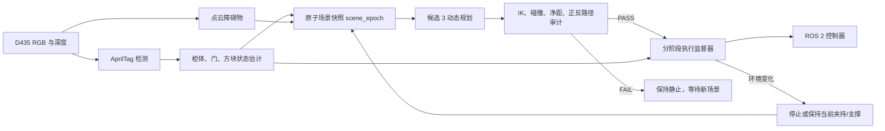

# 826 AprilTag 实时感知与候选 3 自动重规划计划

保存时间：2026-08-26 CST；状态更新：2026-09-14 CST  
状态：A--L 已在 Gazebo 完成；后续 v9/r17 双循环及 v21/r31 雷达地图回归也已验证  
适用范围：Gazebo 仿真；不得解释为实体机器人安全许可

`AGENTS.md` 仍是项目唯一权威交接文档。第 1--18 节保留原始设计文字，不应单独用来
判断当前完成度；实际完成状态以第 19--21 节和对应落盘证据为准。本文不授权跳过
fresh 预检和安全门，任何新的物理执行仍须重新取得用户明确授权。

> 2026-09-04 当前状态覆盖：第 0、17、18 节描述的是计划建立时的历史起点，不再是
> 当前待办。A--L 的实施结果见第 19 节；其后完成的右手单独操作门把手、两次开关门、
> 方块放入并取回原位的 v9/r17 流程见第 20 节，完整雷达地图回归见第 21 节。本文仍是
> 设计与验收边界说明，实际
> 运行权威以 `AGENTS.md` 最靠后的时间小节及对应密封 authority/run 证据为准。

## 0. 用户确认与新对话起点

2026-08-26 用户明确要求：后续任务按照本计划推进，并为新对话做好交接。

新对话的第一项工作固定为阶段 A 的只读审计：确认 D435 图像/CameraInfo/深度话题、
TF、现有视觉包、AprilTag/OpenCV 依赖、模型 visual 接入点以及候选 3 动态规划接入点。
阶段 A 不修改文件、不安装依赖、不重启 Gazebo、不计算或发送轨迹。

阶段 A 报告完成后，再按本计划顺序进入 B–I 的 plan-only 实施。进入 J–L 的任何物理
运动前必须再次得到用户明确授权。

## 1. 目标

把当前的“固定环境、密封关节轨迹重放”升级为：

```text
D435 持续观察环境
  -> AprilTag 和深度点云定位
  -> 原子更新 MoveIt 场景
  -> 只计算候选 3
  -> 自动完成 IK、碰撞和完整安全审计
  -> 审计通过后分阶段执行
  -> 执行中持续监控，环境变化时停止/保持并重规划剩余路径
```

目标不是每个视频帧都重新做一次全局规划。推荐采用双频率架构：

- 感知与状态估计持续运行，目标 `10–30 Hz`；
- 全局重规划由环境稳定或显著变化事件触发；
- 最终短距离接近可在后续加入较高频率视觉伺服；
- 任何新规划都必须完成完整审计后才能执行。

## 2. 第一版环境变化假设

第一版只支持小幅刚体位姿变化：

```text
柜体平移：XY 各约 ±30 mm
柜体 yaw：约 ±5 deg
方块平移：XY 各约 ±50 mm
方块 yaw：约 ±20 deg
```

以下结构保持不变：

- 孵育箱、门、把手和铁架尺寸；
- 正确的门侧边竖直铰链轴；
- 原装 `incubator_assembly.SLDASM` 导出的 STL；
- 方块尺寸 `80 x 160 x 30 mm`；
- 机器人和 D435 安装关系；
- 桌面、铁架拓扑和控制器接口。

如果门轴、把手、铁架高度、方块尺寸或模型碰撞几何发生变化，属于新几何任务，不能
只靠标签位姿变换解决。

## 3. 总体架构



主要新增模块建议：

```text
h1_2_tag_localizer
  AprilTag 检测、时间同步、TF、协方差和稳定门

h1_2_dynamic_scene
  柜体、门、方块和点云障碍的原子 planning-scene 更新

h1_2_candidate3_replanner
  将候选 3 笛卡尔模板变换到当前柜体/方块坐标并重新求 IK

h1_2_execution_supervisor
  分阶段执行、环境偏差监控、停止/保持和剩余路径重规划
```

## 4. AprilTag 布置

推荐最少三个逻辑对象，而不是只依赖两个单标签：

| 对象 | 初始建议 | 作用 |
|---|---|---|
| 柜体固定框架 | ID 10，70–90 mm | 建立柜体、铰链、把手和铁架坐标系 |
| 柜门 | ID 11，60–80 mm | 观测门姿态和门角，验证正确铰链运动 |
| 方块上表面 | ID 20，45–55 mm | 抓取前估计方块 6D 位姿 |
| 方块侧面 | ID 21、22，可选 | 手臂或柜门遮挡上表面时继续定位 |

Gazebo 标签必须只作为 visual 添加：

- 不改变 collision；
- 不改变质量、惯量和摩擦；
- 不增加套筒、盒体、圆柱或其他假抓取结构；
- 标签到物体坐标系的精确变换写入版本化配置；
- 标签纹理、物理尺寸、ID 和 family 必须参与配置哈希。

方块建议使用 tag bundle。柜门标签是强烈建议项：固定柜体标签只能定位柜体，不能在
实体场景中独立观测门角。Gazebo 可以继续使用 `/incubator/joint_states` 交叉验证。

## 5. 相机、坐标和数据接口

### 5.1 输入

```text
/realsense_camera/color/image
/realsense_camera/color/camera_info
/realsense_camera/depth/image
/realsense_camera/depth/points
/joint_states
/incubator/joint_states
TF / TF_STATIC
latch 和 support 状态
```

具体话题名必须在实施前通过当前 live ROS 图重新确认，不能只依赖本文字符串。

### 5.2 输出

建议发布：

```text
/apriltag/detections
/tag_pose/cabinet
/tag_pose/door
/tag_pose/cube
/apriltag/status
/dynamic_scene/status
/candidate3_replan/status
/execution_supervisor/status
```

每个标签状态必须包含：

- tag ID 和 family；
- 图像时间戳；
- 相机坐标系位姿；
- 同一时间戳转换到 robot base/world 的位姿；
- 重投影误差；
- 位姿协方差或置信度；
- 连续成功帧数；
- 最新有效观测年龄；
- 使用的标签尺寸和配置版本。

### 5.3 坐标关系

不再把世界固定坐标直接写入运动逻辑。使用：

```text
camera optical -> robot base/world
cabinet tag -> cabinet frame
cabinet frame -> hinge axis
cabinet frame -> handle grasp frame
cabinet frame -> middle-rack target
door tag -> door frame
cube tag/bundle -> cube frame
cube frame -> cube grasp frame
```

规划目标由相对坐标组合得到。例如：

```text
T_world_rack = T_world_cabinet_tag * T_cabinet_tag_rack
T_world_cube_grasp = T_world_cube_tag * T_cube_tag_grasp
```

这样柜体和方块小幅移动后，开门、抓取和放置目标会跟随新的实测坐标。

## 6. 感知与状态估计流程

1. 获取彩色图像和对应 CameraInfo。
2. 检测 tag 角点和 ID。
3. 使用准确的物理 tag 尺寸估计 6D 位姿。
4. 使用同时间戳 TF 转换到机器人 base/world。
5. 用深度图对标签距离和平面方向做交叉校验。
6. 对相同对象的多标签结果做 bundle 融合。
7. 对位姿做离群值剔除和短窗口滤波。
8. 输出置信度、协方差、观测年龄和稳定状态。
9. 标签跳变、时间戳过期、TF 缺失或 ID 冲突时 fail closed。

初始稳定门建议值，仅供第一次标定试验：

```text
连续有效观测                 5–10 frames
图像与机器人状态时间差       < 100 ms
柜体平移窗口抖动             < 2–3 mm
姿态窗口抖动                 < 0.5–1 deg
重投影误差                   由 Gazebo 实测后确定
```

这些阈值不能直接视为最终值，必须通过静态和动态数据集确定。

## 7. 原子场景快照

环境稳定后生成只读 `scene_epoch`：

```text
scene epoch ID
camera timestamp
cabinet pose/covariance
door pose/angle/covariance
cube pose/covariance
robot joint state
point-cloud obstacle revision
latch and support state
URDF/SRDF/STL hashes
tag configuration hash
planner version
```

规划时冻结这一份快照。感知继续运行，但不能在规划中途偷偷修改场景。若 live 环境与
快照偏差超过允许值，当前规划和证书立即作废，重新等待稳定场景。

MoveIt planning scene 更新必须是原子的：

- 柜体 body、铁架、铰链和把手作为同一个柜体根变换更新；
- 柜门按柜体根坐标和实测门角更新；
- 方块碰撞体按融合标签位姿更新；
- 深度点云继续提供无标签障碍；
- 更新完成前不允许规划线程读取半旧半新的场景。

## 8. 候选 3 动态规划

只计算候选 3，不计算候选 1、2。

现有候选 3 的路径拓扑保留，但改为柜体/方块相对笛卡尔模板：

1. 左手相对把手的预抓取、夹持和旋转圆弧；
2. 左手已验证安全撤离方向；
3. 右手相对柜门把手的预抓取和夹持；
4. 绕实测铰链轴的 601 个门圆弧目标；
5. 左手相对实测方块的抓取；
6. 相对柜体正面的外部安全走廊；
7. 在柜外完成 `yaw=90 deg` 平行定向；
8. 沿柜体开口法向直线插入；
9. 相对中层架中心的下降、松夹和撤离；
10. 右手关门；
11. 左手把手向下回锁。

环境改变后不能把旧关节轨迹整体平移。必须从当前 `/joint_states` 和新的笛卡尔目标重新
求 IK，并生成新的时序轨迹。

## 9. 每次重规划的完整审计

每个 `scene_epoch` 的新候选 3 必须重新执行：

- 完整 IK 和关节限位；
- 最大 `4.9 deg` IK 连续性限制；
- 机器人自碰检查；
- 原装 STL 接触检查；
- 默认 `10 mm` 环境净距；
- 正向和完整反向路径；
- 正确门铰链轴和门把手机构约束；
- 601 个门圆弧目标；
- 密集插值碰撞检查；
- 关节速度、加速度和时序检查；
- 夹持、latch、support 和分段拓扑检查；
- 禁止 partial；
- 最终方块位置、近水平和平行姿态检查。

用户已允许密集样本数不必精确等于旧的 2943。动态路径应按固定空间/关节分辨率生成
样本，不能为了提速降低检查分辨率或跳过区间。

审计通过后生成与 `scene_epoch` 绑定的临时规划证书。证书至少绑定：

```text
scene snapshot hash
trajectory payload hash
model/STL hashes
tag configuration hash
planner/auditor version
clearance and continuity results
forward/reverse audit results
validity tolerance and expiration
```

live 环境超过证书容差后，证书自动失效。

## 10. 分阶段执行监督器

推荐状态机：

```text
WAIT_PERCEPTION_STABLE
  -> BUILD_SCENE
  -> PLAN_CANDIDATE3
  -> FULL_AUDIT
  -> READY
  -> EXECUTE_HANDLE_UNLOCK
  -> VERIFY_DOOR_AND_TAGS
  -> EXECUTE_DOOR_OPEN
  -> VERIFY_CUBE_AND_RACK
  -> EXECUTE_CUBE_PICK
  -> EXECUTE_CUBE_INSERT
  -> VERIFY_CUBE_RELEASE
  -> EXECUTE_DOOR_CLOSE
  -> EXECUTE_HANDLE_RELOCK
  -> FINAL_PHYSICAL_VALIDATION
```

每个阶段开始前比较 live 状态和证书快照：

```text
偏差在容差内                    继续
稳定偏差超过容差                停止并重规划剩余阶段
标签短时丢失                    减速或保持
标签持续丢失                    停止
新障碍进入路径                  停止并重规划
处于夹持或支撑                  保持夹紧/支撑，规划受约束延续
```

自由空间阶段可以停止后重规划。门接触阶段不能突然松夹或解除支撑；必须保持门和当前
机器人状态，再重新生成剩余门圆弧或经过完整审计的恢复路径。

## 11. 方块遮挡处理

方块被左手夹住后，上表面标签可能被遮挡。计划采用：

1. 抓取前使用 tag bundle 获得高置信方块位姿；
2. 抓取成功时记录 `T_gripper_cube`；
3. 标签不可见期间使用机器人 FK 和固定抓持变换跟踪方块；
4. Gazebo 中继续用模型位姿和夹爪反馈做物理交叉验证；
5. 标签重新出现后比较视觉与 FK 估计；
6. 偏差超过门限时停止，不在未知滑移状态继续插入。

柜体固定标签也可能被门或手臂遮挡，因此标签位置和 D435 视野必须在多个动作关键帧中
验证。必要时使用两个柜体固定标签组成 bundle。

## 12. 规划速度优化

当前完整候选 3 搜索可能耗时数分钟。自动重规划需要以下优化，但不能减少安全检查：

1. MoveIt、IK solver、碰撞场景和网格常驻内存；
2. 只计算候选 3；
3. 使用上一条成功解的坐标变换结果作为 warm start；
4. 复用候选 3 笛卡尔拓扑，只重新求受环境变化影响的关节解；
5. 正向、反向和密集碰撞检查并行；
6. 对相近场景缓存 IK 种子，缓存结果仍需在当前场景完整重验；
7. 先做快速可达性筛选，再做完整审计，完整审计前禁止执行；
8. 对最终 `50–100 mm` 自由空间接近阶段评估视觉伺服；
9. 每次测量计划、审计和场景更新时间，定位真正瓶颈。

建议性能目标：

```text
感知更新                         10–30 Hz
稳定场景确认                     0.5–1 s
第一版小变化候选 3 重规划        5–15 s
后续优化目标                     2–5 s
完整机器人动作本体               <= 90 s
```

如果要求机器人在环境持续运动时完全不停顿地重新规划，需要进一步引入局部轨迹优化、
视觉伺服或 MPC；MoveIt 全局规划更适合“检测变化 -> 安全停止/保持 -> 重规划”。

## 13. 实施阶段与交付物

| 阶段 | 工作 | 交付物 | 允许机器人运动 |
|---|---|---|---|
| A | 相机、话题、TF、AprilTag 依赖审计 | 只读审计报告 | 否 |
| B | 标签 ID、尺寸和相对 pose 设计 | tag map 和几何说明 | 否 |
| C | 添加纯 visual 标签 | 模型 visual 与纹理测试 | 否 |
| D | AprilTag 检测和 TF 节点 | 位姿、置信度、状态话题 | 否 |
| E | 静态/动态定位精度测试 | 数据集和误差报告 | 否 |
| F | 原子 dynamic planning scene | scene_epoch 和一致性测试 | 否 |
| G | 候选 3 相对坐标规划器 | 新 IK/轨迹生成器 | 否 |
| H | 完整自动审计和证书 | plan-only PASS/FAIL 证据 | 否 |
| I | 环境扰动矩阵 plan-only 测试 | 成功范围和失败边界 | 否 |
| J | 单阶段物理验证 | 抓取/开门/放置/关门证据 | 是 |
| K | 执行监督和自动重规划 | 停止、保持、剩余路径重规划 | 是 |
| L | 完整闭环、速度优化和录像 | 物理 PASS、视频和新备份 | 是 |

建议先完成 A–I。也就是先做到“持续识别、自动更新场景、自动生成候选 3 并完整审计，
但绝不发送轨迹”。用户审核规划结果和环境适用范围后，再授权 J–L。

## 14. 无运动测试矩阵

第一轮 plan-only 至少覆盖：

```text
柜体 X：-30, -15, 0, +15, +30 mm
柜体 Y：-30, -15, 0, +15, +30 mm
柜体 yaw：-5, -2.5, 0, +2.5, +5 deg
方块 X/Y：边界、中心和组合偏移
方块 yaw：-20, -10, 0, +10, +20 deg
柜体与方块组合扰动
```

还必须测试失败场景：

- 柜体 tag 遮挡；
- 方块 tag 遮挡；
- 错误 tag ID；
- tag 尺寸配置错误；
- 重复 ID；
- 图像过期；
- TF 时间戳不可用；
- 位姿突然跳变；
- 环境持续移动、不满足稳定窗；
- 新障碍进入路径；
- IK 无解；
- 净距不足；
- 反向路径失败；
- 规划完成后场景再次变化。

所有失败必须 fail closed，并明确报告失败门，不得退化为旧固定轨迹硬跑。

## 15. 验收指标

### 感知

- 标签在规划关键姿态持续可见或有合规的 FK 接管；
- 位姿误差和抖动满足实测门限；
- 深度交叉校验通过；
- 过期、跳变、错 ID 和遮挡能可靠触发失败。

### 规划

- 只计算候选 3；
- 环境扰动矩阵中的支持范围全部自动生成完整路径；
- 全部路径无 partial；
- 原装 STL、正确铰链、净距、碰撞、正反和时序检查通过；
- 场景变化能可靠使旧证书失效。

### 执行

- 执行前现场和证书一致；
- 运行中环境变化能停止或保持，不继续盲跑；
- 支撑或夹持状态下不自动 reset、detach 或松夹；
- 方块平行放入中层架；
- 右手关门、左手向下回锁；
- 动作本体目标不超过 90 秒。

### 长期稳定性

当前方块在完成后短时间近水平，但整夜 Gazebo 运行后会漂移并倾倒。该问题必须作为
独立验收项：延长释放后观察时间，优化释放高度、架内目标和接触稳定性。AprilTag
定位和自动重规划本身不能代替这一物理优化。

## 16. 风险与边界

- 单个 torso D435 会受到手臂、柜门和方块遮挡；tag bundle 是必要的稳健性措施。
- AprilTag 只定位有标签物体；无标签障碍仍依赖深度点云。
- 视觉位姿会抖动，不能把每帧结果直接写入控制器。
- 标签解决定位，不会自动保证 IK 可达或碰撞安全。
- 柜体移动后所有原固定关节轨迹和旧安全证书都失效。
- 快速 warm-start/cache 只能加速，不能跳过当前场景完整重验。
- Gazebo 验证不是实体机器人安全许可；若以后进入实体，需要重新标定、重新建模风险和
  独立安全控制器。

## 17. 实施前需要确认的决策

在开始修改前需要确认：

1. 第一版是否接受“柜体、柜门、方块”三类标签，而不是只有柜体和方块两个标签；
2. 预期环境变化是否只包含柜体/方块平移和 yaw；
3. 第一版是否先只实现 A–I 的 plan-only 自动重规划；
4. 90 秒指标是否只统计机器人动作，还是包含感知稳定和重新规划时间；
5. 方块长期稳定性是否与 AprilTag 改造同时优化，还是作为后续独立阶段；
6. 新成果备份编号及命名规则，禁止覆盖现有 826.2。

## 18. 当前未实施声明

保存本计划时尚未：

- 修改任何模型或源码；
- 生成 AprilTag 纹理；
- 安装新依赖；
- 启动检测器；
- 重启 Gazebo；
- 更新 planning scene；
- 计算新 IK 或候选 3；
- 运行预检或发送控制器轨迹；
- 创建新成果备份。

下一步应先做阶段 A 的只读审计，并在用户确认第 17 节决策后再进入实施。

## 19. 2026-08-27 实施状态覆盖

第 18 节是计划保存时的历史声明。阶段 A 只读审计完成后，用户先后要求继续 A--I，
并在看到最终 H/I PASS/支持边界以及 J--L 需另行授权的提示后，明确要求继续完成。
该后续授权严格限于 Gazebo 仿真。

当前 A--L 已按阶段完成；E/J/K/L 最终证据见：

```text
runtime_evidence/826_apriltag_execution_20260827/REPORT.md
runtime_evidence/826_apriltag_execution_20260827/SHA256SUMS
```

attempt11 的完整动作本体为 87.809367723 s、8,713 点，经过 fail-closed 保持和剩余路径
重规划后得到 `COMPLETE_PASS`，并交付完整录像和非覆盖 `827` 备份。执行过程中没有
降低 601 目标、10 mm 净距、4.9 deg 连续性、正反路径、原装 STL/正确铰链和禁止
partial 合同。

第 15 节的整夜方块接触稳定性仍作为独立验收项；本轮三次一致的释放后短期样本不能
外推为整夜 PASS。实体机器人仍未授权，Gazebo PASS 不能作为真机许可。

## 20. 2026-09-09 后续双循环流程状态覆盖

在 A--L 完成后，用户继续要求把流程扩展为：右手单独操作门把手，左手不接触把手；
第一次开门后左手把方块放入并关门上锁；再次开门后左手把方块取回出生原位，最后由
右手关门上锁。该完整 Gazebo 双循环已经完成并多次以不同相机角度原速重放。

当前动作语义权威为：

```text
authority    runtime_assets/candidate3_roundtrip_831_authority_v9/
base run     runtime_assets/candidate3_roundtrip_831_r17/
result       PASS，cube=origin，door=locked
timing       invocation-to-PASS 164.523835390 s；motion 161.871759013 s
safety       left_handle_commands=0；handle contacts=0；torso peak <45 deg
rosbag       60 条控制器轨迹消息（16/16/16/4/8）
```

加入 Mid-360 后的最新非覆盖完整重放为：

```text
replay authority  runtime_assets/candidate3_roundtrip_831_authority_v19/
run               runtime_assets/candidate3_roundtrip_831_r29/
flow              invocation-to-PASS 175.159285672 s，PASS
video             post_mid360_roundtrip_full_r29.mp4
video SHA-256      7f77658d9d7cd515503fe66e432b35892d0044ac80d37f6e3f0e9b4e85c1d6c7
```

v19/r29 与 v9/r17、v18/r28 的 16 项身份无关动作、轨迹、世界、控制器和安全 payload
逐字节一致；只改变非覆盖运行身份并验证共享描述加入 Mid-360 后的回归。r29 的 rosbag
含精确 60 条控制消息，通用把手接触话题为 0，最终方块回原位、门和把手约 q0、latch
locked、两个 support detached、五个轨迹话题 publisher 均为 0。完整证据在
`runtime_assets/candidate3_roundtrip_831_r29/RUN_SUMMARY.md`。v18/r28 仍是前一份用户视角
证据，不得删除或覆盖。

最新受保护工作空间备份是 `/home/liu/h1_moveit/backups/909.tar.zst`，其 sidecar
SHA-256 为 `d00e104358c7a74706b86fcac8465200376168e9225fe9f0733568f29a33af1a`。
909 包含 v9/r17、v19/r29、826 A--L、Mid-360/Nav2/V12 和当前工作空间；禁止把备份身份
与动作 authority/run 混为一谈。若以后再次归档，必须使用新的非覆盖编号，不能改写
909。

2026-09-09 10:21 CST 检查时，v19/r29 的 launch、Gazebo server/GUI、bridge、视觉节点
和 controller manager 均已退出，joint-state 话题没有发布者。09:39 成功终态只保留为
历史快照；r29 完整证据已落盘并受 909 保护。未来重演仍必须重新检查现场、建立新的
authority/run 身份，从 fresh 世界按
`launch -> recorder -> support_daemon + preparation` 握手后再进入 flow；daemon 启动
后必须立即并发运行 preparation，不能先等待 socket。

上述工作仍严格限于 Gazebo。实体机器人从未获得执行授权。601 门目标、默认 10 mm
环境净距、4.9 度连续性、原装 STL、正确铰链、完整正反路径、时序审计和禁止 partial
是第 19 节 826 AprilTag 动态规划成果线的合同，仍未放宽。v19/r29 只是密封固定轨迹的
回归与视觉重放，manifest 不要求 live certificate/supervisor，视频本身也不是动作权威；它
不得替代或外推为新的动态 AprilTag 重规划证据。

## 21. 2026-09-14 完整 Mid360 地图双循环状态覆盖

用户进一步要求双循环必须在已完成的雷达地图内运行。fresh v21/r31 将 v9/r17 的固定
动作与 `5 x 5 m`、高 `2.5 m` 四墙 enclosure、Mid360 点云/scan/map/方墙定位组合，完整
双循环在 `167.302430689 s` 内 PASS。终态方块回原位、门 locked、两个 support detached，
控制消息仍为 `60=16/16/16/4/8`，把手接触 0，躯干峰值小于 45 度；Mid360 同时保持
720 点、4 墙、有效定位。

```text
authority  runtime_assets/candidate3_roundtrip_831_authority_v21/
run        runtime_assets/candidate3_roundtrip_831_r31/
report     runtime_assets/candidate3_roundtrip_831_r31/RUN_SUMMARY.md
report SHA 1189c500f8dd0a47ab03f7bd465fac144bd28b493b2eed7707c31717a55c5a65
```

本节只覆盖“完整雷达地图中的固定双循环回归”。第 19 节 826 AprilTag A--L 动态规划成果
仍独立有效，v21/r31 不替代也不外推为动态重规划证据；动作语义权威仍是 v9/r17。最新
受保护恢复点仍是 914，但其创建早于 v21/r31，因此不包含本节成果。Gazebo 已正常退出，
未创建备份或连接实体机器人。

## 22. 2026-09-14 导航后 AprilTag 把手对准：D1 离线结果覆盖

用户确认新的组合目标：以名义开箱站位作为 Nav2 最终目标；机器人停止并稳定后，使用
箱体固定 Tag 10/12 恢复箱体 pose，以刚性几何偏移得到闭门 q0 时的把手 pose，Tag 11
交叉检查门 pose，再重新生成开箱笛卡尔目标、IK 和完整碰撞/时序计划。雷达只负责粗定位，
不得用其残差直接驱动固定关节轨迹。

D1 已完成参考系实现：worker 从冻结 PlanningScene 的精确动态对象反解 pelvis 相对
cabinet/door/handle/cube pose，要求 body/tray/door/cube/guard 与 epoch world pose 共享同一
刚性 `pelvis <- world`，并用实际 pelvis 相对 pose 生成笛卡尔 delta。handle 使用 door、
固定几何偏移和 handle joint 运动学恢复。world 物体包络与 base residual 包络保持独立，
没有修改固定轨迹或直接偏移旧关节角。

已完成的离线门：

1. proper/finite SE(3)、shape id/数量/尺寸、frame、时间、未 attached、共同刚性关系和
   handle 机构一致性均 fail closed；
2. attempt11 CDR 保持原哈希，离线派生只改变新 scene/epoch 身份；
3. 宽域 20 项矩阵证明 0.1 mm/0.01 deg 材料残差均无法通过既有 IK/连续性/自碰撞门；
4. 最终准入只保留双向完整 PASS 的数值零包络：x/y/z ±0.5 um、yaw ±0.0001 deg、tilt
   <=0.00001 deg；这不是可用的 Nav2 到站容差；
5. 最终 admission v2 16/16 预期匹配，7 个准入 case 各 8,713 点、601 目标、10.001 mm
   净距、0.773493305 deg 最大相邻变化、正反路径/时序/no-partial PASS；9 个超包络拒绝；
6. `h1_2_vision` 隔离构建 PASS，112 passed、1 skipped、0 failed。

完整报告为：

```text
runtime_evidence/826_post_nav_apriltag_alignment_20260914/REPORT.md
final summary SHA-256 888734ea2e561d2cce3f112a6694439a23140312d44852601fa5b3c84fb485c3
```

因此 D1 的几何/参考系代码已完成，但材料级导航后开箱明确未完成。下一开发应先离线重设
有 IK/连续性裕量的名义站位或笛卡尔路径并重复矩阵；不得直接进入动作执行。只有另获
Gazebo 联调授权并且先得到材料级完整证书包络后，才可建立全新身份做“导航停止、直立/
速度/定位门、标签稳定、scene freeze、certificate、执行”。

Tag 11 只固定于门，不等于把手全程固定；把手转动后必须结合 door/handle joint 运动学。
完整双循环也不能只解决把手阶段，仍须使用 cube tags 和既有 support/latch 安全合同。

## 23. 2026-09-14 D1a 离线路径裕量状态覆盖

D1a 已完成第一轮站位和路径裕量诊断，但没有得到材料成功域。正式 g5 下 34 个非零
单轴/对角站位候选全部失败；g6--g12 的冗余分支和局部 Cartesian detour 试验也不能同时
通过 nominal、IK、4.9 度连续性、自碰、601 门目标、10 mm、时序和正反路径门，已完整
回退。仅保留不改变安全判定的 C++ 首碰撞对诊断。

最终 h1 attempt11 回归 16/16 预期匹配、7 项完整 PASS、9 项超包络前置拒绝；summary
SHA-256 为 `83aee54d55b07bdd5012a506dcd04c18b2e66bb3d8fce0c1ce4eb9fc7caa7d35`。准入仍
只是 x/y/z `+/-0.5 um`、yaw `+/-0.0001 deg` 的数值零包络，不是 Nav2 容差。

下一阶段仍属于 D1a 离线开发：应绕开 door raw 471 附近奇异区、为 handle 腕关节限位和
腕/肘对 torso 自碰建立材料裕量，并重做正负基座矩阵；不得只改变 Nav2 goal、放宽安全门
或进入 Gazebo。完整诊断见
`runtime_evidence/826_post_nav_apriltag_alignment_20260914/D1A_MARGIN_DIAGNOSIS.md`。

## 24. 2026-09-14 D1b 固定外参开门状态覆盖

第 22--23 节“材料级未通过”已被新的右手开门 plan-only 结果部分覆盖。视觉合同现为：
Tag 10/12 是 cabinet authority；door 和 handle 均从 cabinet 固定机构链及 joint angle
推导；Tag 11 只做 5 mm/2 deg 门 pose 交叉检查。Nav2 必须已到目标、连续驻足至少 30 s、
直立，标签/TF fresh，scene 与 epoch 必须共享同一 `pelvis<-world`，certificate hash 必须
绑定计划；否则 fail closed。

新的 `826-a6` 右手 worker 不直接偏移旧关节角，而是基于当前 pelvis 相对箱体 pose 对三段
开门 Cartesian 路径重新求 IK，并完成 601 门目标、10 mm 净距、4.9 deg 连续性、FCL、
正反路径、时序和 no-partial 审计。attempt11 admission 37/37 预期匹配，24 项完整 PASS，
13 项预期拒绝，summary SHA-256 为
`8601182017e084e9cd26db3dfcd7a9418ee166bedb87a2bc52240dc3ed5879c7`。

x/y/z ±1 mm、yaw ±0.1 deg、tilt ±0.05 deg 只作为前置候选包络；一个仍在包络内的组合被
完整自碰审计拒绝，因此每次 live 视觉 pose 必须重新运行完整 planner/auditor。完整报告：
`runtime_evidence/826_post_nav_apriltag_alignment_20260914/D1B_FIXED_OFFSET_OPEN_REPORT.md`。

此覆盖只完成离线右手开门 plan-only，不是 Nav2/Gazebo/执行或完整双循环成功。旧导航
`(-0.45,0,0)` 仍是接近点，约 `(0,0,0)` 最终操作 goal 和较长步行未验证；三段计划尚未
接入执行 supervisor，完整双循环仍需 cube tags。进入 Gazebo 必须重新取得授权并创建
全新身份；不得覆盖既有 authority/run，备份仍需用户给新编号。

## 25. 2026-09-15 固定动作用户视角重放覆盖

用户明确要求打开 Gazebo 查看开箱效果后，分支 G 的 fresh v23/r33 在完整四墙 Mid360
场景完成固定双循环，调用至 PASS `176.938775168 s`。60 条控制消息、左手把手命令 0、
把手接触 0、躯干小于 45 deg、方块 origin、门 locked、两个 support detached、rosbag、
视频和终态审计全部 PASS。入口为
`runtime_assets/candidate3_roundtrip_831_r33/RUN_SUMMARY.md`。

前一身份 v22/r32 因 D1a 重链接后的主 install plugin 与 support 合同摘要不符，在
preparation 和动作前 fail closed，控制命令 0，已封存。Gazebo 离线后从保护备份 914
恢复合同绑定 plugin，随后才建立 v23/r33；没有修改本文件第 24 节的 D1b plan-only 资产。

本节只增加固定 v9/r17 动作在 v21 场景中的最新视觉/回归证据，不能覆盖第 24 节的边界：
D1b 新三段计划仍未接入执行 supervisor，Nav2 最终 operation goal/30 s 驻足/实时 tags
闭环未执行，完整双循环仍需 cube tags。09:55 CST Gazebo GUI/server 仍按用户要求打开，
但 flow/support/recorders 已退出且现场安全锁止；以后必须重新只读核验。

## 26. 2026-09-15 915 模板备份状态覆盖

用户指定的完整工作空间备份 915 已发布并成为最新保护恢复/开发模板：
`/home/liu/h1_moveit/backups/915.tar.zst`，SHA-256
`2148b1f083f4fa28ce647c8e8ca4debf4fc49a92ee26f0bfe5eb3428a9beea0c`。它包含归档截止前的
D1b 固定 Tag 外参实现/矩阵以及 v23/r33 固定重放。归档和 sidecar 为只读、非覆盖，全部
结构/哈希/媒体门 PASS；完整报告在
`runtime_evidence/backup_915_release_20260915/REPORT.md`。

915 只改变保护恢复基线，不覆盖本计划的成果语义：D1b 仍是右手开门 plan-only，尚无
Nav2 后 live tags/Gazebo 执行，完整双循环仍需 cube tags。动作权威仍是 v9/r17，固定视觉
证据仍是 v23/r33。备份前已正常关闭 Gazebo，当前 live 离线。

## 27. 2026-09-15 独立步态 r29 离线状态说明

用户继续优化步态产生了独立的 Unitree 导航成果线 r29：正常授权且输入落入 deadband 时
按既有加速度限制渐变至 exact zero，故障门仍立即 exact zero。其纯函数矩阵、50 项聚焦
测试和 122 项隔离包测试 PASS，但没有运行 Gazebo，严格连续 30 秒 0.08 m 驻足成功仍为
0。报告在
`runtime_evidence/unitree_h12_incubator_nav2_authorized_deadband_slew_20260915_r29/REPORT.md`。

本节不覆盖第 22--24 节 AprilTag/D1b 合同或成果：Tag 10/12 固定外参开门仍只到 plan-only，
Nav2 后 live tags/Gazebo 执行和完整 cube-tag 双循环仍未完成。915 仍是最新模板且不含 r29；
任何 Gazebo 步态验证仍需用户新授权和新 identity，真机未授权。

## 28. 2026-09-16 独立步态 r30 失败说明

Unitree 步态成果线的 r29 zero-slew 已在 fresh r30 Gazebo 运行中因
`STABLE_HOLD_TIMEOUT` 被拒绝并回退 915。它没有执行 AprilTag、D1b 或开箱动作，不改变
第 22--24 节视觉固定外参合同。严格 30 秒/0.08 m PASS 仍为 0。

## 29. 2026-09-16 独立步态 r31 离线说明

用户要求学习 `/home/liu/test` 后，独立步态线新增默认关闭的 V12 learned STOP 候选：官方
Unitree policy 继续处理非零 MOVE，V12 只处理 exact-zero 后的 BRAKE/RECOVER/HOLD。34 项
聚焦、122 项隔离测试和旧 r30 trace 矩阵 PASS，但未运行 Gazebo，不能证明闭环平衡或
30 秒驻足。

本节同样不覆盖 AprilTag/D1b：Tag 10/12 固定外参、Tag 11 检查、scene certificate 和
attempt11 右手开门仍只到 plan-only；完整双循环仍需 cube tags。任何 Gazebo 步态验证或
D1b 联调均需各自新的明确授权和全新 identity，真机未授权。

## 30. 2026-09-16 独立步态 r60 失败说明

r31 learned STOP 在 fresh r60 Gazebo 中因 physical path envelope 后续 FALL_ENVELOPE 被拒绝，
BRAKE 56/HOLD 0、strict PASS 0，源码已回退 915。本结果完全属于独立步态线，没有执行
AprilTag、D1b、开箱、cube 或 support，不覆盖第 22--24 节 plan-only 合同。当前 GUI 只保留
失败姿态供查看，禁止 reset；后续 D1b Gazebo 联调仍需其自己的明确授权和新身份。
